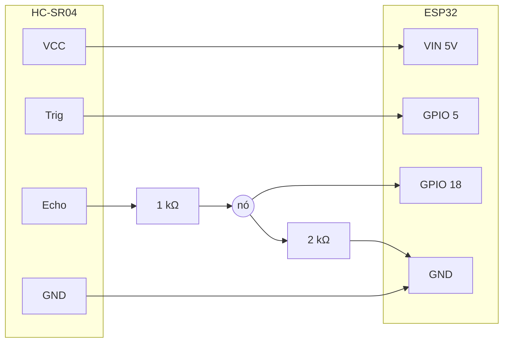

# Manual de montagem do controle — "Perdido no tempo"

**Versão: ESP32 + mini protoboard + 1 sensor ultrassônico (HC-SR04)**

Neste jogo, o controle é a **sua mão**. O sensor ultrassônico mede a que distância a mão está, e o ESP32 avisa o computador pelo cabo USB. O jogo (no navegador) transforma essa distância em escolhas:

- **Cada faixa de distância é uma opção** (mão perto = primeira opção, mais longe = as de baixo).
- **Deixe a mão parada por cerca de 1 segundo** para confirmar.
- **Aproxime a mão bem rápido do sensor e tire** (um "toquinho no ar") para **voltar / fechar**.

Isso é de propósito: controlar com a mão no ar é meio difícil e impreciso, como o Seu Antônio se sente com as telas da cidade.

---

## 1. Lista de materiais

| Qtd | Item | Observação |
|----:|------|-----------|
| 1 | ESP32 DevKit V1 (30 ou 38 pinos) | |
| 1 | Sensor ultrassônico **HC-SR04** | 4 pinos: VCC, Trig, Echo, GND |
| 1 | Mini protoboard (170 furos) | |
| 1 | Cabo USB **de dados** | Cabo só de carregar **não funciona** |
| 4 a 6 | Jumpers **macho-fêmea** | Do ESP32 até a protoboard |
| 2 a 3 | Jumpers **macho-macho** | Dentro da protoboard |
| 2 | Resistores: **1 kΩ e 2 kΩ** | Para o divisor de tensão. Veja a seção 3 se não tiver |

Coisas que já vêm na placa e o jogo usa:
- **LED azul** do ESP32 (GPIO 2): pisca quando você acerta ou erra.
- **Botão BOOT** do ESP32 (GPIO 0): funciona como atalho de "OK", se quiser.
- O **som** sai pelo computador.

Ferramentas: computador com **Google Chrome ou Microsoft Edge** e a **Arduino IDE 2** (https://www.arduino.cc/en/software).

---

## 2. Como o sensor funciona (1 minuto de teoria)

O HC-SR04 é como um morcego. Quando o ESP32 manda um pulso no pino **Trig**, o sensor solta um "grito" de ultrassom (que a gente não ouve). O som bate na sua mão e volta. Enquanto o som está viajando, o pino **Echo** fica ligado. O ESP32 mede quanto tempo o Echo ficou ligado e calcula:

```
distância (cm) = tempo do eco (microssegundos) ÷ 58
```

(Divide por 58 porque o som anda cerca de 1 cm a cada 29 µs, e ele vai **e** volta.)

---

## 3. O cuidado mais importante: o divisor de tensão

O HC-SR04 funciona com **5 V**, e o pino **Echo** devolve **5 V**. Só que os pinos do ESP32 aguentam no máximo **3,3 V**. Ligar o Echo direto pode, com o tempo, estragar o pino.

A solução é um **divisor de tensão**: dois resistores que "baixam" os 5 V para cerca de 3,3 V.

```
 Echo do sensor (5 V) ──[ 1 kΩ ]──┬──────── GPIO 18 do ESP32 (recebe ~3,3 V)
                                  │
                               [ 2 kΩ ]
                                  │
                                 GND
```

A conta: `5 V × 2k ÷ (1k + 2k) = 3,33 V`. 

**Não tem resistor de 2 kΩ?** Coloque **dois de 1 kΩ em série** (um depois do outro) no lugar dele. Qualquer trio de resistores **iguais** serve (três de 1 kΩ, três de 10 kΩ, três de 220 Ω...): um em cima e dois em série embaixo.

**Não tem nenhum resistor?** Você tem duas saídas:

1. **Teste alimentar o sensor com 3,3 V** (ligue VCC no pino **3V3** em vez do VIN). Aí o Echo também sai em 3,3 V e pode ir direto no GPIO 18, sem resistor. Muitos sensores novos (**HC-SR04P** ou **RCWL-1601**) funcionam assim. O HC-SR04 antigo às vezes não funciona em 3,3 V: se o Monitor Serial mostrar só `DIST:-1`, volte para a opção 2.
2. **Ligar em 5 V sem divisor** costuma funcionar em projetos escolares curtos, mas é fora do limite do ESP32 e **não é recomendado**. Se for fazer, é por sua conta, e o ideal é conseguir os resistores (custam centavos).

---

## 4. Ligações

### 4.1 Tabela

| Pino do HC-SR04 | Vai para | Observação |
|-----------------|----------|-----------|
| **VCC** | **VIN** do ESP32 (5 V do USB) | Na opção sem resistor, use **3V3** |
| **Trig** | **GPIO 5** (D5) | Direto, sem resistor (o ESP32 manda 3,3 V, o sensor entende) |
| **Echo** | **GPIO 18** (D18), **pelo divisor** | 1 kΩ entre Echo e D18; 2 kΩ entre D18 e GND |
| **GND** | **GND** do ESP32 | |

> Em algumas placas o pino VIN aparece como **5V** ou **VUSB**. É o mesmo: são os 5 V que vêm do cabo USB.

### 4.2 Desenho do circuito

```
     HC-SR04 (olhos para frente)
   ┌───────────────────────────┐
   │   ( )               ( )   │
   │  VCC   Trig   Echo   GND  │
   └───┬──────┬──────┬──────┬──┘
       │      │      │      │
       │      │    [1kΩ]    │
       │      │      ├──────┼──────────────── GPIO 18 (D18)
       │      │    [2kΩ]    │
       │      │      │      │
       │      │      └──────┤
       │      │             │
       │      └─────────────┼──────────────── GPIO 5 (D5)
       │                    └──────────────── GND
       └───────────────────────────────────── VIN (5V)
                                               ESP32
```

### 4.3 O mesmo esquema em diagrama (Mermaid)



### 4.4 Montagem na mini protoboard, passo a passo

O ESP32 é largo e **não cabe bem** na mini protoboard. Então a placa fica do lado, e você liga com jumpers **macho-fêmea** (a ponta fêmea encaixa direto no pino do ESP32).

A mini protoboard tem **17 colunas**, cada uma com 5 furos ligados entre si (de cima para baixo, de cada lado do vale). Vamos usar só a metade de cima.

1. **Desligue o USB** enquanto monta.
2. Encaixe o **HC-SR04** na beirada da protoboard, com os "olhos" virados para fora, e cada pino numa coluna diferente. Exemplo: VCC na coluna 1, Trig na 2, Echo na 3, GND na 4.
3. **Resistor de 1 kΩ:** uma perna na **coluna 3** (Echo) e a outra na **coluna 8**.
4. **Resistor de 2 kΩ:** uma perna na **coluna 8** e a outra na **coluna 4** (GND).
5. Jumpers macho-fêmea até o ESP32:
   - coluna 1 (VCC) → **VIN**
   - coluna 2 (Trig) → **D5**
   - coluna 8 (meio do divisor) → **D18**
   - coluna 4 (GND) → **GND**
6. Confira com a tabela antes de ligar o USB. Atenção: **VCC e GND trocados queimam o sensor.**

```
 Mini protoboard (vista de cima, metade de cima)
 coluna:  1    2    3    4    5    6    7    8
         VCC  Trig Echo GND                 
          │    │    └─[1kΩ]───────────────┐ 
          │    │         └───[2kΩ]────────┤ (2kΩ vai da coluna 8 até a 4)
          │    │                          │ 
        (VIN) (D5)       (GND)          (D18)    ← jumpers macho-fêmea até o ESP32
```

### 4.5 Posição do sensor para jogar

- Deixe o sensor **em pé, olhando para cima** (você mexe a mão por cima dele, como num teremim) ou **olhando para você** em cima da mesa.
- Use a **palma da mão aberta**, reta, de frente para o sensor. Dedos e mangas largas confundem a leitura.
- A área de jogo vai de uns **6 cm até uns 45 cm** do sensor. Nada mais pode estar nessa frente (copo, celular, parede).

---

## 5. Gravando o firmware

### 5.1 Preparar a Arduino IDE (só uma vez)

1. Abra a Arduino IDE → **Arquivo → Preferências**.
2. Em "URLs adicionais do Gerenciador de Placas", cole:
   `https://espressif.github.io/arduino-esp32/package_esp32_index.json`
3. **Ferramentas → Placa → Gerenciador de Placas**, procure **esp32** (da Espressif) e clique em **Instalar**.
4. Escolha: **Ferramentas → Placa → esp32 → ESP32 Dev Module**.

Não precisa instalar nenhuma biblioteca.

### 5.2 Driver USB (se a porta não aparecer)

Olhe o chip ao lado do conector USB da placa:
- **CP2102 / CP2104** → instale o driver "CP210x" da Silicon Labs.
- **CH340 / CH9102** → instale o driver "CH340/CH341" da WCH.

No Windows 10/11 geralmente instala sozinho. Depois, tire e coloque o cabo de novo.

### 5.3 Enviar o código

1. Abra `firmware/perdido_controle/perdido_controle.ino` na Arduino IDE.
2. **Ferramentas → Porta**: escolha a porta da placa (Windows: `COM3`, `COM4`...; Linux: `/dev/ttyUSB0`; Mac: `/dev/cu.usbserial-...`).
3. Clique na seta **→ (Carregar)**.
4. Se aparecer `Connecting........_____`, **segure o botão BOOT** da placa até começar a gravar, e solte.
5. Espere "Hard resetting via RTS pin...". O LED azul pisca 2 vezes: está funcionando.

---

## 6. Testando

### 6.1 Monitor Serial (sem o jogo)

1. **Ferramentas → Monitor Serial**, velocidade **115200 baud**, fim de linha **Nova linha (Newline)**.
2. Aperte o botão **EN/RST** da placa. Deve aparecer `HELLO:PERDIDO:2:ESP32`.
3. Mexa a mão na frente do sensor. Devem aparecer linhas como:
   ```
   DIST:12
   DIST:15
   DIST:-1      ← nada na frente
   ```
4. Aperte o botão **BOOT**: aparece `BTN:A:1` e, ao soltar, `BTN:A:0`.
5. Digite comandos no campo de envio (Enter para mandar):
   - `BLINK:3` → o LED azul pisca 3 vezes.
   - `LED:1` acende, `LED:0` apaga.
   - `DELAY:800` → as distâncias passam a chegar quase 1 s atrasadas. `DELAY:0` volta ao normal.
   - `SONAR:0` para de mandar distâncias; `SONAR:1` volta.
   - `PING` → responde `PONG`.
6. **Feche o Monitor Serial** antes de abrir o jogo. Só um programa usa a porta por vez.

### 6.2 Com o jogo

1. Abra o jogo no **Chrome** ou **Edge** (link da Vercel ou local; veja o README).
2. Clique em **"Conectar controle"** e escolha a porta da placa. Isso só é preciso **na primeira vez**.
3. Nas próximas vezes, é só ligar o cabo USB: o jogo conecta sozinho.
4. No menu, entre em **"Testar controle"**: aparece uma régua mostrando onde sua mão está e as faixas de cada opção.

---

## 7. Solução de problemas

| Problema | O que fazer |
|----------|-------------|
| A porta não aparece | Troque o cabo (muitos são só de carga). Instale o driver CP210x ou CH340 (5.2). Teste outra porta USB. |
| Upload trava em `Connecting....` | Segure **BOOT** no começo da gravação. |
| Só aparece `DIST:-1` | Confira VCC no **VIN** (5 V) e GND. Confira Trig no D5 e o divisor indo para o D18. Se ligou VCC no 3V3, seu sensor pode não aceitar: use 5 V com o divisor. |
| A distância pula muito | Use a palma aberta e reta. Tire objetos da frente do sensor. Não deixe o sensor apontado para uma parede próxima. |
| A distância fica parada num número | O divisor pode estar invertido: o **1 kΩ** fica do lado do Echo e o **2 kΩ** do lado do GND. |
| Letras estranhas no Monitor Serial | Velocidade errada: use **115200**. Um pouco de "lixo" ao ligar é normal no ESP32. |
| O jogo diz "porta ocupada" | Feche o Monitor Serial da Arduino IDE ou a outra aba do jogo. |
| O jogo diz "navegador não suportado" | A Web Serial só funciona no **Chrome** ou **Edge** no computador. Use o teclado como alternativa. |
| O LED azul não pisca | Algumas placas não têm LED no GPIO 2. Não faz mal: o som do computador continua funcionando. |
| A placa reinicia quando o jogo conecta | Normal: o ESP32 reinicia ao abrir a porta e manda `HELLO`. O jogo espera isso. |

---

## 8. Sem placa? Jogue no teclado

| Ação | Tecla |
|------|-------|
| Mover a escolha (como mexer a mão) | Setas **↑ ↓** (ou W / S) |
| Confirmar | **Enter** ou **Espaço** |
| Voltar / fechar | **Esc** ou **Backspace** |
| Simular a mão do sensor | **Q** aproxima, **E** afasta, **R** tira a mão |
