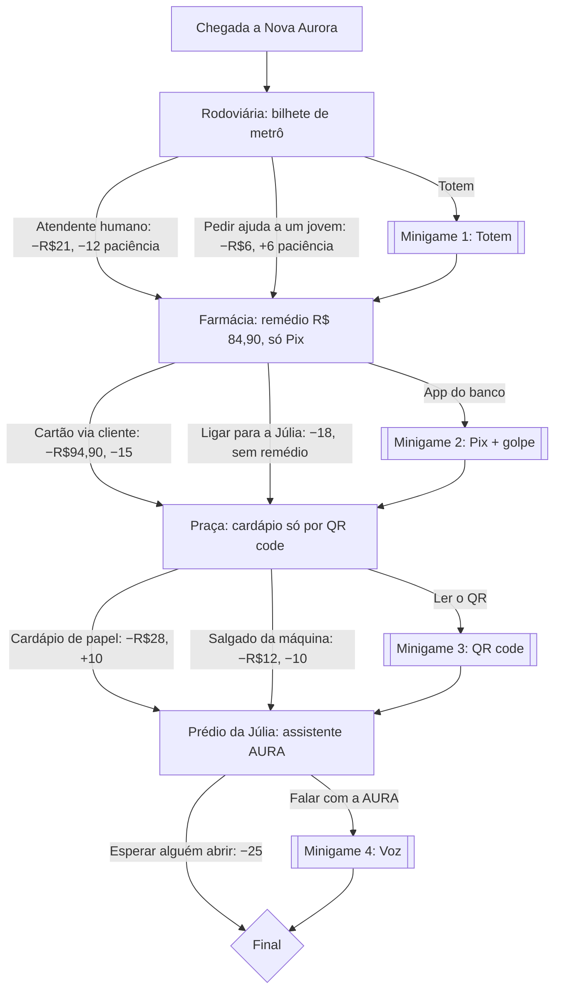

# Plano do projeto — "Perdido no tempo"

## 1. Visão

**Tema:** inclusão digital de idosos.
**Pergunta do projeto:** o que acontece com quem não acompanhou a tecnologia numa cidade que só funciona por telas, apps e códigos?

O jogador vive um dia do **Seu Antônio**, 72 anos, ex-metalúrgico, aposentado com **R$ 1.400**, que chega a **Nova Aurora** para o aniversário da neta Júlia. É uma história com escolhas. Algumas escolhas abrem minigames. Tudo mexe em dois números:

- **Saldo** (começa em R$ 1.400): taxas, assinaturas sem querer, golpes.
- **Paciência** (começa em 80 de 100): se chegar a 0, o jogo acaba no final "Perdido no tempo".

O controle reforça a mensagem: o jogador usa **a mão no ar diante de um sensor ultrassônico**, um controle impreciso e, em algumas fases, **lento de propósito**. A dificuldade física faz o jogador sentir um pouco do que o Seu Antônio sente.

**Tom:** crítico (golpes, taxas, atendimento só por máquina) e esperançoso (gentileza, aprendizado, propostas de mudança).

## 2. Roteiro e fluxo das escolhas



**Finais** (o primeiro que se aplicar):

| Final | Condição | Mensagem |
|-------|----------|----------|
| Perdido no tempo | paciência chegou a 0 (a qualquer momento) | A cidade andou rápido demais e esqueceu de esperar. |
| O preço da pressa | caiu em golpe | Golpes miram quem tem menos familiaridade. Ele vira voluntário contra golpes. |
| Uma cidade para todos | saldo ≥ R$ 1.200 e paciência ≥ 55 | Ele e a neta propõem "botões gentis" à prefeitura. |
| Chegou, mas a que preço | qualquer outro caso | "E quem vai ensinar a cidade a ter calma comigo?" |

Se ele ficou sem o remédio, o final acrescenta essa lembrança.

## 3. Minigames

Todos usam a mão (distância = opção, mão parada ≈ 1,3 s = confirma, toquinho no ar = voltar) e têm alternativa no teclado.

| # | Minigame | Como joga | Dificuldade "de idoso" | Ganhar | Perder |
|---|----------|-----------|-------------------------|--------|--------|
| 1 | **Totem** | 2 passos: achar "Bilhetes e Recarga" e depois "Unitário R$ 6,00" entre 7 opções parecidas | Faixas de só 4 cm, letra pequena, atraso de 300 ms, propagandas que **assinam** se a mão ficar parada (R$ 29,90) | −R$ 6 | −R$ 21 e −15 |
| 2 | **Pix** | Escolher a chave certa (4 quase iguais), resistir à mensagem "URGENTE: INSS bloqueado", escolher o valor (84,90 / 8,49 / 849,00 / 48,90) e conferir o nome do recebedor | Atraso de 250 ms; a opção do golpe fica na faixa mais "natural" | −R$ 84,90 | golpe (−R$ 297 ou o valor pago a um estranho), valor errado, ou sem remédio |
| 3 | **QR code** | A mão é o celular: manter a distância na faixa de foco, que fica mudando, até encher a barra (3 s) | Atraso de 200 ms, imagem borrada fora do foco, tremor | −R$ 32 (PF) | −R$ 12 e −15 |
| 4 | **Voz (AURA)** | 3 rodadas: escolher a frase que a máquina entende ("Abrir portaria.", "Apartamento oitocentos e dois.", nome completo) | Atraso de 300 ms; as frases naturais do Antônio são entendidas tortas | +5 paciência (−6 por mal-entendido) | 4 mal-entendidos ou tempo: −20/−22 |

## 4. Arquitetura

```
 ┌──────────────────────────┐   USB (115200 baud)   ┌──────────────────────────────────┐
 │ ESP32 + HC-SR04          │ ───── DIST:23 ──────▶ │ Navegador (Chrome/Edge)           │
 │ firmware/perdido_controle│ ◀──── DELAY:300 ───── │ js/serial.js  Web Serial          │
 │ - mede distância         │                       │ js/input.js   mão + BOOT + teclado │
 │ - BOOT = OK              │                       │ js/handmenu.js zonas e régua       │
 │ - LED azul = feedback    │                       │ js/game.js    telas e história     │
 │ - fila de atraso         │                       │ js/minigames/ 4 minigames          │
 └──────────────────────────┘                       │ Canvas 960×540 + Web Audio         │
                                                    └──────────────────────────────────┘
                                 hospedado como site estático na Vercel (HTTPS)
```

- **Sem backend e sem build**: HTML + CSS + módulos JS. Fácil de entender e publicar.
- `js/protocol.js` é "puro" (não usa o navegador): parser, comandos, detector de toquinho e zonas da mão. Por isso é testado no Node.
- O atraso das fases difíceis é aplicado **na placa** (comando `DELAY`), como um aparelho lento de verdade. No teclado, o atraso é simulado no navegador.

### Bluetooth (BLE) como segundo caminho

Computadores da escola podem não ter o driver do chip USB (CP2102/CH340) e não deixar instalar. Por isso o firmware também é um periférico **BLE** chamado `PerdidoNoTempo`, com um serviço no estilo **Nordic UART** (`6E400001-…`; RX `…0002` para comandos, TX `…0003` com notificações). As mensagens e comandos são **os mesmos** do cabo; as linhas vão em pedaços de 20 bytes e o `LineSplitter` remonta. O jogo usa **Web Bluetooth** (Chrome/Edge): o primeiro uso pede um clique em "Conectar por Bluetooth"; quedas são reconectadas sozinhas (até 6 tentativas com espera crescente); e, onde o navegador oferece `navigator.bluetooth.getDevices()`, reconecta até depois de recarregar a página. O BLE exige a partição **Huge APP** (o programa fica maior que 1,2 MB).

### Gravação sem instalar nada

O GitHub Actions compila o firmware com `arduino-cli` (core ESP32 3.0.7) e salva um `.bin` único (offset `0x0`) em `gravar/`. A página `/gravar` usa o **ESP Web Tools** (copiado em `vendor/`, sem CDN) para gravar pelo navegador via Web Serial, inclusive no Chrome do Android com OTG (via WebUSB, sem driver).

### Por que Web Serial?

| Opção | Por que não / por que sim |
|-------|---------------------------|
| **Web Serial (escolhida)** | O jogo continua sendo só um site na Vercel. Fala direto com a porta USB do ESP32, sem instalar nada. Permite autoconexão com portas já autorizadas. Funciona com qualquer ESP32 comum (CP210x/CH340). |
| ESP32 como teclado USB (HID) | O ESP32 clássico (DevKit V1) **não** tem USB nativo; só o S2/S3. E teclado não recebe comandos de volta (atraso, LED). |
| Bluetooth / Wi-Fi (WebSocket) | Exige servidor local ou pareamento, e a Vercel não hospeda servidor WebSocket persistente. Mais pontos de falha para iniciante. |
| App Python/Node no PC fazendo ponte | Precisa instalar e rodar outro programa antes de jogar. |
| WebUSB | No Windows não acessa CP210x/CH340 sem instalar driver (WinUSB). No Android funciona, e é o que a página de gravação usa lá. |
| **Bluetooth LE (também usado)** | Sem driver e sem pareamento. Usado como segundo caminho para jogar quando o PC não tem o driver USB. |

**Limitações aceitas:** só Chrome/Edge no computador (o jogo avisa e libera o teclado) e a primeira conexão exige um clique de permissão (regra de segurança do navegador).

### Autodetecção

1. Ao abrir a página: `navigator.serial.getPorts()` devolve portas já autorizadas, e o jogo conecta sozinho.
2. Evento `connect`: plugou o cabo de uma porta já autorizada, o jogo conecta sozinho.
3. Evento `disconnect`: o jogo avisa, continua no teclado e espera o próximo `connect`.
4. Primeira vez: botão **Conectar controle**, que chama `requestPort()` com filtros USB (CP210x `0x10C4`, CH340/CH9102 `0x1A86`, Espressif `0x303A`, FTDI `0x0403`). O link "não apareceu?" abre o seletor sem filtro.
5. Ao abrir a porta o ESP32 reinicia. O jogo ignora o lixo do boot e manda `HELLO` até receber `HELLO:PERDIDO:2:ESP32` (ou qualquer `DIST` válido).

## 5. Protocolo serial

Texto, uma mensagem por linha (`\n`), **115200 baud**.

**Placa → PC**

| Mensagem | Quando |
|----------|--------|
| `HELLO:PERDIDO:2:ESP32` | ao ligar e ao receber `HELLO` |
| `DIST:<cm>` | a cada medida que mudou (máx. ~16 por segundo) e a cada 400 ms como "batimento". `DIST:-1` = nada na frente (fora de 2 a 80 cm) |
| `BTN:A:1` / `BTN:A:0` | botão BOOT apertado / solto |
| `PONG` | resposta ao `PING` |
| `OK:SONAR:1`, `OK:DELAY:300`, `OK:RESET` | confirmações |
| `ERR:<comando>` | comando desconhecido |

Pelo **Bluetooth**, as mesmas linhas chegam como notificações da característica TX, em pedaços de até 20 bytes.

**PC → Placa** (pelo cabo ou escrevendo na característica RX do Bluetooth)

| Comando | Efeito |
|---------|--------|
| `HELLO` | pede apresentação |
| `PING` | teste de vida |
| `SONAR:<0\|1>` | liga/desliga o envio de `DIST` (começa ligado) |
| `DELAY:<ms>` | atrasa tudo que a placa envia (0 a 3000 ms) |
| `LED:<0\|1>` | LED azul aceso/apagado |
| `BLINK:<n>` | pisca o LED n vezes (1 a 10) |
| `RESET` | sem atraso, LED apagado, sonar ligado |

**Gestos (interpretados no jogo, em `js/protocol.js`)**

| Gesto | Regra |
|-------|-------|
| Escolher | opção `i` = faixa `[9 + 8·i, 9 + 8·(i+1))` cm (o totem usa faixas de 4 cm) |
| Confirmar | mão na mesma faixa por 1,3 s. Para confirmar de novo, mexer a mão 6 cm ou trocar de faixa |
| Voltar | entrar em < 7 cm e sair (para ≥ 9 cm ou sumir) em menos de 0,7 s |

## 6. Fases de implementação

| Fase | Entrega | Status |
|------|---------|--------|
| 0 | Montagem do circuito e teste no Monitor Serial (`DIST` aparecendo) | a fazer pelo aluno, com o manual |
| 1 | Firmware: medida com mediana de 3, batimento, BOOT com debounce, fila de atraso, LED | ✅ |
| 2 | Protocolo + testes no Node (parser, zonas, toquinho, re-arme) | ✅ |
| 3 | Conexão Web Serial com autodetecção e reconexão; aviso de navegador; teclado | ✅ |
| 4 | História, saldo/paciência, 4 finais | ✅ |
| 5 | 4 minigames com a mão | ✅ |
| 6 | Tela "Testar controle" com régua de distância | ✅ |
| 7 | Deploy na Vercel | a fazer pelo aluno, com o README |
| 8 | Playtest com colegas: ajustar `HAND.ZONE`, `HAND.DWELL`, tempos e atrasos | a fazer |

**Ideias para depois:** narração em áudio; placar de finais desbloqueados; modo "neta ajudando" (dicas); trocar o HC-SR04 por dois sensores para ter esquerda/direita.

## 7. Critérios de pronto

- [ ] Com o circuito montado, o Monitor Serial mostra `HELLO:PERDIDO:2:ESP32` e `DIST:<cm>` mudando com a mão.
- [ ] No Chrome/Edge, depois de autorizar uma vez, recarregar a página conecta sozinho, e tirar/colocar o cabo reconecta sem clicar.
- [ ] Firefox/Safari mostram o aviso e o jogo funciona inteiro no teclado.
- [ ] "Testar controle" mostra a distância, as faixas e reconhece confirmar (mão parada e BOOT) e o toquinho.
- [ ] É possível terminar o jogo e chegar aos 4 finais.
- [ ] Nas fases lentas, a resposta chega atrasada também com o controle (comando `DELAY` aplicado na placa).
- [ ] `npm test` passa.
- [ ] Publicado na Vercel com HTTPS, e o controle funciona no link publicado.

## 8. Validação já feita

- `npm test`: 10 testes do protocolo e dos gestos passando.
- `npm run test:firmware`: o firmware real compilado com um Arduino simulado responde certo a `PING`, `DELAY`, `SONAR`, `RESET`, comando inválido, botão BOOT e distâncias (com `DELAY:500`, a distância chega 501 ms depois).
- Teste no Chromium com uma porta serial falsa: autoconexão por `getPorts`, `HELLO` depois do lixo de boot, navegação com a mão, envio de `SONAR`/`DELAY`/`LED`, desconexão e reconexão automática pelo evento `connect`, o QR code vencido seguindo o foco, e o jogo no teclado sem Web Serial (aviso visível).
- Bluetooth testado no Chromium com um aparelho BLE falso: conectar, receber linhas em pedaços de 20 bytes, enviar comandos e reconectar sozinho após uma queda.
- A compilação real com o core oficial do ESP32 roda no GitHub Actions a cada mudança no firmware.
- Ainda **não** testado: o sensor e o Bluetooth com a placa física.
